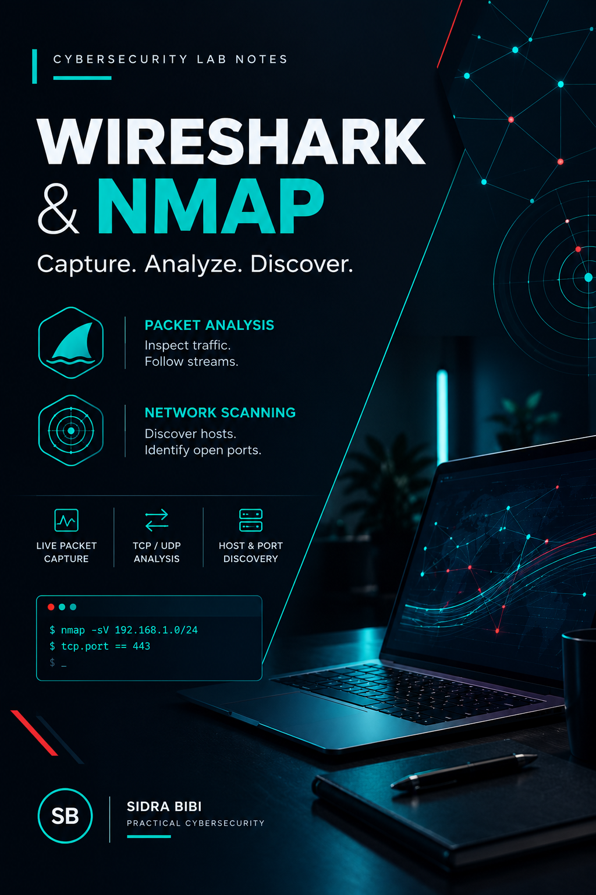

# Wireshark & Nmap Network Analysis Lab

A hands-on cybersecurity lab on network traffic analysis and port scanning using Wireshark and Nmap, done from a defensive (SOC) point of view.

## What I Practiced
- Captured live network traffic and analyzed packets
- Filtered TCP, UDP, DNS, and ICMP traffic
- Detected TCP retransmissions and suspicious traffic
- Inspected packets and read network statistics
- Scanned ports and detected running services
- Analyzed open, closed, and filtered ports

## Tools Used
- Wireshark: captures and analyzes packets
- Nmap: scans hosts for open ports and services
- Zenmap: graphical interface for Nmap

## Files
- Wireshark_Nmap_Lab.pdf : full document with steps and screenshots
- images/title.png : title image

## Key Learning
Understanding network communication, identifying suspicious traffic, and analyzing exposed ports from a defensive security perspective.

## Note
All practice was done in a legal lab environment on systems I own or have permission to test.

**Author:** Sidra Bibi
